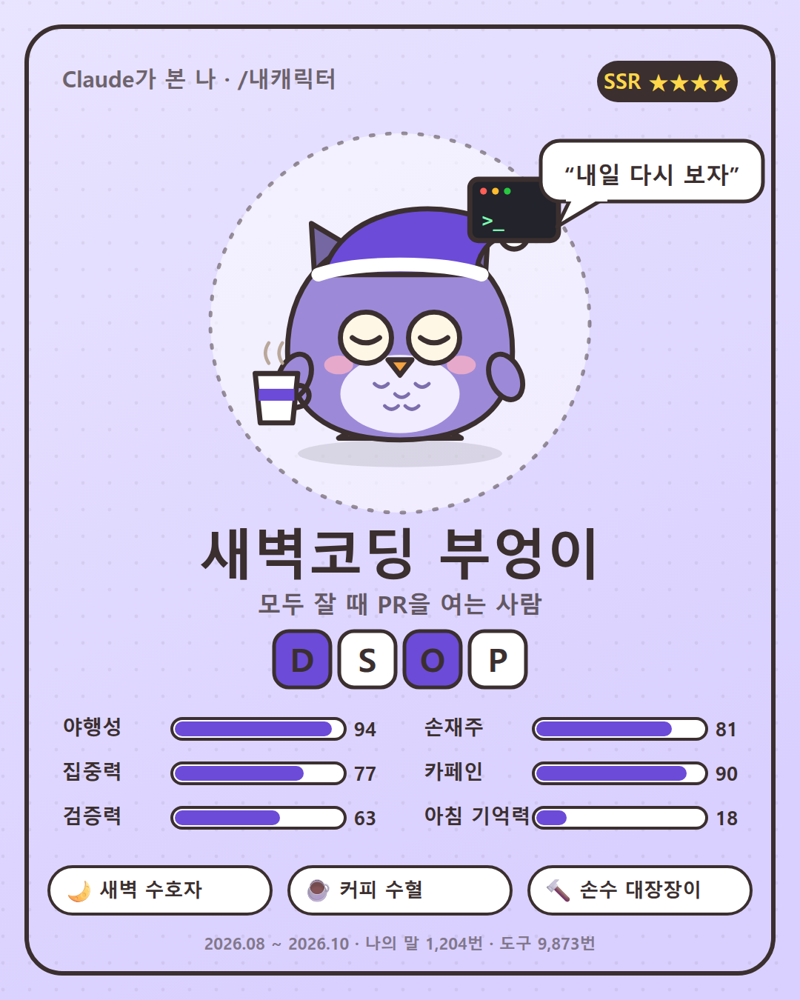

# /내캐릭터

Claude Code에서 `/내캐릭터`를 입력하면 내 세션 기록을 전부 훑어서 나를 닮은 캐릭터를 그려 주는 스킬입니다.
성격, 4글자 개발 유형 코드, 등급, 능력치, 입버릇, 배지, 동료 궁합까지 숫자 근거와 함께 나옵니다.



(가상의 사람으로 만든 예시입니다)

## 설치

```bash
git clone https://github.com/palendy/claude-my-character ~/.claude/skills/내캐릭터
```

Python 3만 있으면 됩니다. 따로 설치할 패키지는 없습니다.

## 사용

| 입력 | 결과 |
|---|---|
| `/내캐릭터` | 전체 기간으로 분석 |
| `/내캐릭터 30` | 최근 30일만 |

결과는 `~/내캐릭터/` 아래 HTML 한 장으로 나옵니다. 페이지 맨 아래 [PNG로 저장]을 누르면 공유용 카드(1080×1350)를 받습니다.

## 어떻게 만드나

1. `scripts/analyze.py`가 `~/.claude/projects/` 아래 세션 기록에서 내가 보낸 말만 골라 셉니다.
   시간대, 말투, 입버릇, Claude가 쓴 도구, git 기록 같은 것들입니다.
2. Claude가 그 숫자를 읽고 성격과 능력치를 씁니다. 모든 항목에 숫자 근거를 붙이고, 놀림은 기본이 매운맛입니다.
3. `scripts/render.py`가 동물 15종, 눈 8개, 입 7개, 소품 26개를 조합해 캐릭터와 결과 페이지를 그립니다.

유형 코드와 등급은 Claude가 고르지 않습니다. Claude는 말마다 업무인지 딴짓인지만 표시하고, 나머지는 모두 같은 공식으로 계산하니 동료끼리 비교할 수 있습니다.

| 축 | 왼쪽 | 오른쪽 | 무엇을 세나 |
|---|---|---|---|
| 업무 | W 업무형 | D 딴짓형 | 무작위로 뽑은 내 말 90개 중 일과 상관없는 말이 다섯에 하나를 넘나 (Claude가 하나씩 읽고 표시) |
| 말 길이 | S 한마디형 | L 브리핑형 | 25자 이하 말과 100자 이상 말 중 어느 쪽이 많나 |
| 일하는 방식 | O 한우물형 | M 멀티형 | 다른 대화를 돌리는 중에 보낸 말이 30%를 넘나 |
| 시간 | A 오전형 | P 오후형 | 말의 절반을 오후 2시 전에 보냈나 |

## 내 기록은 어디로 가나

PC 밖으로 나가지 않습니다. 웹 검색, 업로드, 외부 API 호출을 하지 않고, 결과 페이지도 인터넷 없이 열립니다.
공유 카드에는 프로젝트명이나 사람 이름을 넣지 않게 되어 있습니다.
